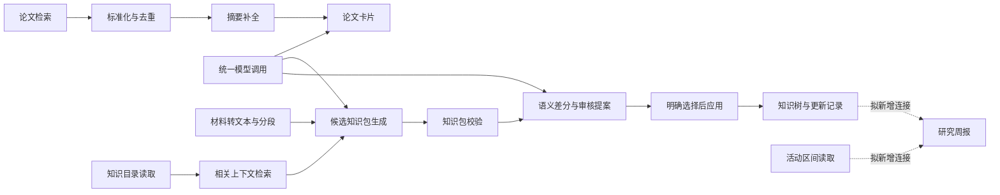

# 四项目接口提取审核与排名

日期：2026-09-18。对象：`article`、`chatgpt_playwright`、`lifelog`、`oled` 的当前本地代码。以“今后项目能够持续复用”为目标；本次给出候选与实施顺序，没有迁移源码、发布服务或把候选直接登记成已可用工具。

**近期优先：论文标准化去重、知识关联树、论文检索、知识目录读取。** `web_gpt` 已经可接入且有实际调用方，但要先统一运行与错误约定。长期值得投入的是语义差分和审核后入库；它们目前耦合较重。

## 1. 评估方法与验证边界

按 1–5 评分：复用面 30%、成熟度 25%、提取容易度 20%、运行稳定性 15%、现有项目联动收益 10%。总分 = 6×复用 + 5×成熟 + 4×容易 + 3×稳定 + 2×联动。高分表示适合优先做成可靠的复用接口。

- 复用面：从单一页面到多类项目；成熟度：从想法到已独立发布/完整接口验证；容易度：从需重构业务系统到已有模块；稳定性：从依赖易变页面到确定性本地逻辑；联动：与现有工具链可明确组合的收益。
- 分数是基于当前实现的工程判断，不是性能、科研质量或商业价值实测。5 分以内应视作同一优先层，不应为 1 分差距强行改变开发计划。
- 同分按复用面、联动、成熟度排序；候选有依赖关系，分数不能相加当作“总收益”。提取成本是相对工作量，不是未经实现验证的工期承诺。
- “已有项目 HTTP”表示接口存在于业务服务中；“可提取模块”表示实现已存在但仍需独立配置/契约；拟议函数签名不代表已经实现。
- 审查范围覆盖当前主要实现、接口入口及相关测试；没有运行真实搜索 API、浏览器生成、Ollama 推理或 Supabase 读写，没有将 archive/vendor/experiments 中的历史工具计作当前能力。

| 验证对象 | 本次结果 | 能说明什么 |
| --- | --- | --- |
| article | `PYTHONDONTWRITEBYTECODE=1 /Users/xiaoyanhao/venv/article/bin/python -m unittest discover -s tests -v`：37 项通过 | 网络与模型用测试替身；标准化、检索控制、摘要/卡片处理、SQLite 与本机 HTTP 行为通过 |
| OLED 摄入模块 | 在 app/tools 运行 `PYTHONDONTWRITEBYTECODE=1 python3 -m unittest test_semantic_diff test_structured_ingestion test_update_history test_output_bridge -v`：55 项通过 | 包括临时知识库副本的实际应用、七项构建、回滚与桥接；模型判断为测试替身 |
| OLED 独立知识树 | 同日上一轮 12 项测试通过；本次核对清单指纹仍一致 | 离线算法、当前数据、CLI、HTTP；没有必要重复同一验证 |
| LifeLog | `node node_modules/typescript/bin/tsc -p tsconfig.app.json --noEmit --incremental false` 通过；评分和周期课程纯函数抽查通过 | 源码类型/模块逻辑；不证明线上数据库默认值与 RLS 正确 |
| chatgpt_playwright | 7 组纯逻辑抽查通过：分段边界/文本保留、JSON 提取、包合并和重复 ref | 不证明 PDF/Office 转换、登录态、嵌入召回或浏览器生成可用 |

## 2. 影响接口化判断的发现

1. **article 已发生跨项目联动，但 README 滞后。** `SearchConfig` 的 `backfill_abstracts` 和 `generate_cards` 默认都是 True；`cards.py` 会导入 `web_gpt`。README 的“不调用 LLM”已不反映当前默认流程。纯检索接口应使用独立 client；如走组合流程，应显式控制增强开关。调用方环境变量是 `WEB_GPT_PARENT`，不同于工具目录示例使用的 `WEB_GPT_IMPORT_ROOT`。见 [models.py:9](/Users/xiaoyanhao/Desktop/article/src/models.py:9)、[main.py:41](/Users/xiaoyanhao/Desktop/article/src/main.py:41)、[cards.py:72](/Users/xiaoyanhao/Desktop/article/src/cards.py:72)。

2. **OLED 当前实际配置使用网页模型比较。** 仅白名单读取配置字段，看到 `provider=chatgpt_browser`、`model=chatgpt-web-current`、`browser_concurrency=3`；代码同时支持 Ollama。旧 README 写的“只用本机 Ollama”不足以判断当前数据流。见 [semantic_diff.py:27](/Users/xiaoyanhao/Desktop/oled/app/tools/semantic_diff.py:27) 与 [chatgpt_comparison.py:15](/Users/xiaoyanhao/Desktop/oled/app/tools/chatgpt_comparison.py:15)。

3. **浏览器能力被分成几套维护。** `chatgpt_core.py` 与 `web_gpt/core.py` 有 44 个同名函数，其中 3 个 AST 实现不同；`article` 使用新包，`submit` 和 OLED worker 仍使用旧核心。OLED worker 已提供独立页面、发送锁、进程超时和完成检查，但 `web_gpt` 没有统一使用这些机制。因此“全桌面并发”尚未获得统一协调，现有队列内的锁不能约束直接调用新包的项目。见 [worker:49](/Users/xiaoyanhao/Desktop/oled/app/tools/chatgpt_comparison_worker.py:49)、[staging_queue:31](/Users/xiaoyanhao/Desktop/oled/app/tools/staging_queue.py:31)。建议共用底层运行时，保留上层业务协议。

4. **材料检索预算不是硬保证。** `_fit_budget` 最后允许超限并告警，`build_catalog` 也会在命名命中超出数量上限时裁掉部分概念；`full_catalog` 为进程缓存。可作为检索原型，但接口需返回真实体积、遗漏和数据版本。见 [oled_kb.py:248](/Users/xiaoyanhao/Desktop/chatgpt_playwright/oled_kb.py:248)。

5. **LifeLog 的可复用核心主要在数据规则，业务 API 还未分离。** 评分 payload 已独立；活动查询/写入仍嵌在 UI，保存依赖数据库为 user_id 提供契约；本地没有足够的迁移/RLS 材料作线上验证。计划状态只在组件内存。不能将“云端活动记录”扩大描述成已有通用日历或行为分析服务。见 [ratingMetrics.ts:42](/Users/xiaoyanhao/Desktop/lifelog/src/ratingMetrics.ts:42)、[App.tsx:244](/Users/xiaoyanhao/Desktop/lifelog/src/App.tsx:244)、[SchedulePage.tsx:25](/Users/xiaoyanhao/Desktop/lifelog/src/SchedulePage.tsx:25)。

## 3. 各项目内部排名与候选边界

### article

| 项目内名次 | 候选接口 | 分数 | 当前形态 | 提取成本 |
| --- | --- | --- | --- | --- |
| 1 | 论文元数据标准化与去重 | 95 | 可提取模块 | 低 |
| 2 | 论文检索 | 85 | 可提取模块；已有项目 CLI/HTTP | 低 |
| 3 | 按 DOI 补全摘要 | 77 | 可提取模块 | 低 |
| 4 | 选择记录与探索路径存储 | 75 | 可提取模块；已有项目 HTTP | 中 |
| 5 | 论文筛选卡片生成 | 71 | 可提取模块；已接入 web_gpt | 中 |

**1. 论文元数据标准化与去重**（综合第 1）

现有入口：`normalize_papers(records, discovered_at=None)；deduplicate(papers)`。

建议契约（待提取/完善）：`normalize_and_deduplicate(records, source, discovered_at) → papers + diagnostics`。

输入输出与价值：统一 Paper 字段、稳定身份、DOI/标题规范化、去重后的论文集合。 用于：论文检索、书目导入、研究资料去重；可为 article 与 OLED 的来源记录建立身份对照。

需要处理：当前 normalize_papers 主要解析 Semantic Scholar 字段；增加其他来源需单独适配。deduplicate 会补写保留的 Paper 对象；需声明输入可变性或复制输入。src 包名过于通用，独立发布时重命名。

源码依据：[normalize.py:39](/Users/xiaoyanhao/Desktop/article/src/normalize.py:39)、[normalize.py:89](/Users/xiaoyanhao/Desktop/article/src/normalize.py:89)、[models.py:44](/Users/xiaoyanhao/Desktop/article/src/models.py:44)。

**2. 论文检索**（综合第 3）

现有入口：`SemanticScholarClient.search(SearchConfig, on_page=None)`。

建议契约（待提取/完善）：`search_papers(query, limit, years, mode) → papers + query_metadata`。

输入输出与价值：候选原始论文记录，或组合标准化模块得到 Paper 列表；保留来源、模式和分页信息。 用于：研究选题、知识库补充资料、专题追踪、候选文献收集。

需要处理：已有网络重试和分页测试，但本次未验证外部 API 实时可用性。应独立调用 client，或显式关闭 SearchConfig 的 backfill_abstracts/generate_cards；当前两项默认 True。main.run 会写文件并可能调用浏览器，不适合作为“纯搜索”接口。

源码依据：[semantic_scholar.py:27](/Users/xiaoyanhao/Desktop/article/src/semantic_scholar.py:27)、[main.py:41](/Users/xiaoyanhao/Desktop/article/src/main.py:41)、[models.py:9](/Users/xiaoyanhao/Desktop/article/src/models.py:9)。

**3. 按 DOI 补全摘要**（综合第 8）

现有入口：`backfill_abstracts(papers, session=None, sleep=...)`。

建议契约（待提取/完善）：`lookup_abstract(doi) → abstract + provider + status`。

输入输出与价值：当前原地填充缺失摘要，返回填充数量；顺序尝试 OpenAlex 与 Crossref。 用于：提升现有候选文献摘要覆盖，供筛选卡片和研究摘要使用。

需要处理：当前只有总数和日志，未把补全来源/逐条失败写回 Paper；应增加来源、查询时间、无结果/失败区分。实时 API 能力未验证，当前实现的认证/限流适配也需接入前核对。

源码依据：[backfill.py:38](/Users/xiaoyanhao/Desktop/article/src/backfill.py:38)、[backfill.py:65](/Users/xiaoyanhao/Desktop/article/src/backfill.py:65)。

**4. 选择记录与探索路径存储**（综合第 10）

现有入口：`ExplorationStore.add_round / save_selection / snapshot`。

建议契约（待提取/完善）：`create_round / save_selection(expected_revision) / export_exploration`。

输入输出与价值：SQLite 保存轮次、候选快照、选择事件和分支，支持乐观并发检查及取消后保留后代。 用于：文献筛选历史、研究决策过程记录；其他对象的选择树需要额外泛化。

需要处理：记录以 Paper 为数据对象；若推广到其他选项需要对象适配。HTTP 写入口依赖本机 Host 与 X-Review-Token，不能把现有页面接口直接宣称为远程通用服务；JSON/HTML 导出无恢复导入。

源码依据：[exploration.py:26](/Users/xiaoyanhao/Desktop/article/src/exploration.py:26)、[review_app.py:63](/Users/xiaoyanhao/Desktop/article/src/review_app.py:63)。

**5. 论文筛选卡片生成**（综合第 14）

现有入口：`generate_cards(papers, topic, ask=None, batch_size=8)；parse_cards(text, size)`。

建议契约（待提取/完善）：`generate_paper_cards(papers, topic, model_client) → cards + per_paper_status`。

输入输出与价值：基于标题和摘要生成研究问题、方法、核心发现、主题相关原因；不是全文阅读。 用于：论文快速筛选、研究候选说明、阅读清单。

需要处理：默认直接操控浏览器；已支持注入 ask，适合保留。解析允许部分字段/缺卡，没有严格实现提示词中的 80 字限制和完整性要求；补重复 index 检查、逐篇状态、batch_size 校验与来源定位。

源码依据：[cards.py:18](/Users/xiaoyanhao/Desktop/article/src/cards.py:18)、[cards.py:32](/Users/xiaoyanhao/Desktop/article/src/cards.py:32)、[cards.py:72](/Users/xiaoyanhao/Desktop/article/src/cards.py:72)。

### chatgpt_playwright

| 项目内名次 | 候选接口 | 分数 | 当前形态 | 提取成本 |
| --- | --- | --- | --- | --- |
| 1 | 网页版 ChatGPT 调用 | 81 | 已登记独立接口 | 低（加固为中） |
| 2 | 材料转文本与分段 | 76 | 可提取模块 | 中 |
| 3 | 模型 JSON 提取、包合并与校验桥接 | 73 | 可提取模块 | 中 |
| 4 | 按材料检索知识上下文 | 67 | 可提取模块 | 中至高 |
| 5 | 材料到知识包的多轮任务 | 54 | 组合工作流，暂缓通用化 | 高 |

**1. 网页版 ChatGPT 调用**（综合第 5）

现有入口：`ask_once；ChatGPTWeb.ask / start_new_chat`。

建议契约（待提取/完善）：`保持现有公开入口，增加 completion_status、阶段错误和请求追踪`。

输入输出与价值：文本/附件输入，返回回答；多轮复用会话。 用于：article 卡片、内容整理及其他需要网页模型调用的项目。

需要处理：macOS、登录态、页面选择器和剪贴板依赖；answer_timeout 非全程硬超时，可能返回部分文本。两份核心存在差异，OLED 的锁和超时增强尚未统一进该包。

源码依据：[__init__.py:33](/Users/xiaoyanhao/Desktop/chatgpt_playwright/web_gpt/__init__.py:33)、[core.py:757](/Users/xiaoyanhao/Desktop/chatgpt_playwright/web_gpt/core.py:757)、[cards.py:72](/Users/xiaoyanhao/Desktop/article/src/cards.py:72)。

**2. 材料转文本与分段**（综合第 9）

现有入口：`ingest.normalize(path)；split_chunks(text)`。

建议契约（待提取/完善）：`read_document(path, output_dir=None)；chunk_text(text, target_chars, max_chars)`。

输入输出与价值：文本、Office/HTML 文本转换、文本型 PDF 抽字，再按段落/句子分段。 用于：研究资料准备、长文切分、知识摄入前处理。

需要处理：读文件、清洗、落盘和分段参数混在模块全局配置；textutil 限 macOS，PDF 分支需要 pypdf，但当前 requirements.txt 未列出。无 OCR；长度是字符数而不是 token 数；无逐页来源映射；输出路径同名可能覆盖。

源码依据：[ingest.py:82](/Users/xiaoyanhao/Desktop/chatgpt_playwright/ingest.py:82)、[ingest.py:112](/Users/xiaoyanhao/Desktop/chatgpt_playwright/ingest.py:112)、[ingest.py:164](/Users/xiaoyanhao/Desktop/chatgpt_playwright/ingest.py:164)。

**3. 模型 JSON 提取、包合并与校验桥接**（综合第 12）

现有入口：`extract_json；merge_packages；check_payload`。

建议契约（待提取/完善）：`parse_package_reply(text)；merge_packages(parts, validator) → package + issues`。

输入输出与价值：从回答提取 JSON、合并分段包、检查重复 ref/package_id 和未知知识库 ID。 用于：所有分段生成结构化知识包的流程；应作为知识包工具配套模块。

需要处理：校验依赖 OLED structured_ingestion，不能另立一份冲突 Schema。当前 merge_packages([]) 会访问 parts[0]；跨分段 schema_version 一致性也未明确验证。抽出纯合并层并注入权威校验器。

源码依据：[oled_kb.py:381](/Users/xiaoyanhao/Desktop/chatgpt_playwright/oled_kb.py:381)、[oled_kb.py:413](/Users/xiaoyanhao/Desktop/chatgpt_playwright/oled_kb.py:413)、[oled_kb.py:437](/Users/xiaoyanhao/Desktop/chatgpt_playwright/oled_kb.py:437)。

**4. 按材料检索知识上下文**（综合第 16）

现有入口：`build_catalog(source_text, limit=None, budget=...)`。

建议契约（待提取/完善）：`retrieve_context(text, catalog, embedder, budget) → selected_context + omissions`。

输入输出与价值：名称/别名命中优先，嵌入相似度补充，输出精简目录及匹配依据。 用于：为模型准备相关概念背景；它按材料相关性选取，知识树按图关系扩展，两者不等价。

需要处理：绑定 OLED 目录、Ollama 与本地缓存；_full 在进程内缓存，长驻服务需要刷新。budget 实际可超限，且点名概念超过数量限制仍会落选，不能承诺硬上限或全部保留；需显式返回截取/省略信息。

源码依据：[oled_kb.py:82](/Users/xiaoyanhao/Desktop/chatgpt_playwright/oled_kb.py:82)、[oled_kb.py:248](/Users/xiaoyanhao/Desktop/chatgpt_playwright/oled_kb.py:248)、[oled_kb.py:287](/Users/xiaoyanhao/Desktop/chatgpt_playwright/oled_kb.py:287)。

**5. 材料到知识包的多轮任务**（综合第 20）

现有入口：`submit.process(page, source, template, args)；submit.main`。

建议契约（待提取/完善）：`submit_material_job(source, template, config) → job_id；get_job(job_id)`。

输入输出与价值：材料转换、上下文检索、多轮生成、一次修复、合并输出；完整 CLI 成功后移动源文件至 processed。 用于：研究材料结构化的端到端任务，依赖多个前置工具，不宜当作第一批通用接口。

需要处理：浏览器、模型、知识库、文件状态强耦合；命令行跳过已存在输出不能代替按内容幂等。应先稳定各个原子模块，再定义任务状态、取消、恢复和副作用。

源码依据：[submit.py:62](/Users/xiaoyanhao/Desktop/chatgpt_playwright/submit.py:62)、[staging_queue.py:105](/Users/xiaoyanhao/Desktop/oled/app/tools/staging_queue.py:105)。

### lifelog

| 项目内名次 | 候选接口 | 分数 | 当前形态 | 提取成本 |
| --- | --- | --- | --- | --- |
| 1 | 分类评分规则与有效载荷生成 | 78 | 可直接复用的 TS 模块 | 低 |
| 2 | 按日期/区间读取活动 | 66 | 逻辑嵌入页面，需服务层 | 中 |
| 3 | 周期计划按日期展开 | 60 | 可提取 TS 函数 | 低至中 |
| 4 | 活动新增与删除 | 56 | 逻辑嵌入页面，需服务层 | 中至高 |

**1. 分类评分规则与有效载荷生成**（综合第 7）

现有入口：`ratingMetrics(category, subcategory)；ratingPayload(..., location)`。

建议契约（待提取/完善）：`沿用函数接口；把评分配置和 schema_version 显式化`。

输入输出与价值：返回可用评分维度，过滤非当前类别字段和非法评分；保留空值语义与版本 2，位置单独保存。 用于：习惯记录、学习记录、实验活动记录的评分表单和数据规范。

需要处理：目前绑定个人活动分类；其他项目需注入分类配置。非法评分当前被省略，作为严格 API 时应同时返回问题列表。无需先包成 HTTP。

源码依据：[ratingMetrics.ts:7](/Users/xiaoyanhao/Desktop/lifelog/src/ratingMetrics.ts:7)、[ratingMetrics.ts:40](/Users/xiaoyanhao/Desktop/lifelog/src/ratingMetrics.ts:40)。

**2. 按日期/区间读取活动**（综合第 17）

现有入口：`TodayRecords.load 内的 Supabase 查询`。

建议契约（待提取/完善）：`list_activities(start, end, timezone, cursor) → activities + next_cursor`。

输入输出与价值：已有跨午夜重叠查询、当前用户过滤和分页；可整理成区间读取接口。 用于：周报、时间分配、阅读/科研活动汇总的数据入口；统计逻辑本身尚未实现。

需要处理：目前只取当天、返回字段不包含全部评分；统计用途需扩展字段。依赖登录态和 Supabase RLS，本地没有完整数据库迁移/策略材料可核验，不能据前端断言线上授权正确；应注入 client 并补稳定分页。

源码依据：[TodayRecords.tsx:30](/Users/xiaoyanhao/Desktop/lifelog/src/TodayRecords.tsx:30)。

**3. 周期计划按日期展开**（综合第 18）

现有入口：`coursesForDate(date)`。

建议契约（待提取/完善）：`expand_weekly_rules(date, rules, start_date, end_date, exceptions)`。

输入输出与价值：按照星期生成当天课程实例与稳定 ID。 用于：周期阅读、课程和训练计划；通用化需把课表移出函数配置。

需要处理：当前是固定个人课表和截止日期，仅限制结束日期，没有通用开始日期/节假日/例外规则，也没有完整输入校验。SchedulePage 的自建计划和修改仅存 React 内存，不是持久化日历接口。

源码依据：[weeklyCourses.ts:15](/Users/xiaoyanhao/Desktop/lifelog/src/weeklyCourses.ts:15)、[SchedulePage.tsx:25](/Users/xiaoyanhao/Desktop/lifelog/src/SchedulePage.tsx:25)。

**4. 活动新增与删除**（综合第 19）

现有入口：`App.handleSave；TodayRecords.confirmDelete`。

建议契约（待提取/完善）：`create_activity(activity, idempotency_key)；delete_activity(id)`。

输入输出与价值：新增一段活动及评分；按用户与记录 ID 删除，并核对返回的删除 ID。 用于：研究助手或其他应用登记已发生的活动；应先完成只读接口再开放写入。

需要处理：保存没有提交 user_id，依赖现有数据库默认值/策略；读取上一结束时间也依赖 RLS。需核对数据库契约、明确认证上下文、增加幂等与重试行为；未发现活动更新接口，不宣称完整 CRUD。此次未读写云端数据。

源码依据：[App.tsx:215](/Users/xiaoyanhao/Desktop/lifelog/src/App.tsx:215)、[TodayRecords.tsx:61](/Users/xiaoyanhao/Desktop/lifelog/src/TodayRecords.tsx:61)。

### oled

| 项目内名次 | 候选接口 | 分数 | 当前形态 | 提取成本 |
| --- | --- | --- | --- | --- |
| 1 | 关键词知识关联树 | 94 | 已登记独立接口 | 低 |
| 2 | 知识目录与完整概念读取 | 85 | 已有函数与项目 HTTP | 低 |
| 3 | 知识包结构与引用校验 | 78 | 可提取模块 | 中 |
| 4 | 带原文定位的语义差分 | 74 | 可提取模块 | 中至高 |
| 5 | 知识包预览、选项审核与应用 | 71 | 已有领域接口与桥接流程 | 高（通用化） |
| 6 | 知识更新记录与证据读取 | 71 | 已有函数与项目 HTTP | 中 |

**1. 关键词知识关联树**（综合第 2）

现有入口：`extract(params, data_root)；独立 CLI；GET /health、GET /tool、POST /extract`。

建议契约（待提取/完善）：`沿用现有接口，补版本化分发和使用方记录`。

输入输出与价值：按关键词/ID 返回受节点数、深度、强度约束的阅读树、原始关系与来源。 用于：研究问答上下文、主题阅读、知识浏览和相关概念发现。

需要处理：算法独立但输入仍需 OLED 数据布局与索引 2.0；向任意知识库泛化另需数据适配。关联树不是科学因果结论。

源码依据：[core.py:320](/Users/xiaoyanhao/Desktop/oled/knowledge_tree_tool/core.py:320)、[server.py:19](/Users/xiaoyanhao/Desktop/oled/knowledge_tree_tool/server.py:19)。

**2. 知识目录与完整概念读取**（综合第 4）

现有入口：`structured_ingestion.catalog()；GET /api/ingestion/catalog`。

建议契约（待提取/完善）：`get_catalog(data_root, revision=None)；get_concept(id, fields)`。

输入输出与价值：已有完整概念目录，包括身份/别名、正文、属性、情形、公式和枚举，附知识库版本。 用于：浏览器生成的背景目录、知识检索、其他研究项目的稳定 ID/正文读取。

需要处理：catalog() 依赖 graph_storage.ROOT，全量返回可能较大；单概念 get_concept 是拟议新增入口。先参数化 data_root 和字段选择，不需模型。

源码依据：[structured_ingestion.py:61](/Users/xiaoyanhao/Desktop/oled/app/tools/structured_ingestion.py:61)、[serve_local.py:122](/Users/xiaoyanhao/Desktop/oled/app/tools/serve_local.py:122)。

**3. 知识包结构与引用校验**（综合第 6）

现有入口：`validate_package；resolve；concept_properties.validate_links；导入时进一步检查`。

建议契约（待提取/完善）：`validate_knowledge_package(package, catalog) → issues + resolved_references`。

输入输出与价值：校验包级结构、来源 ref、概念/属性引用与条目约束，为导入提供入口。 用于：article 卡片转知识包、模型输出验收、离线预检查；应是全项目共用的权威知识包规范。

需要处理：validate_package 单函数并不完成全部概念/属性引用和语义判断，部分检查分散在 ingest_package；需要划分静态校验与模型比较。来源引用有效不能证明引文真实性。

源码依据：[structured_ingestion.py:95](/Users/xiaoyanhao/Desktop/oled/app/tools/structured_ingestion.py:95)、[structured_ingestion.py:46](/Users/xiaoyanhao/Desktop/oled/app/tools/structured_ingestion.py:46)、[concept_properties.py:7](/Users/xiaoyanhao/Desktop/oled/app/tools/concept_properties.py:7)。

**4. 带原文定位的语义差分**（综合第 11）

现有入口：`semantic_diff.compare(item, existing, trace_path, client=None, ...)`。

建议契约（待提取/完善）：`compare_knowledge(incoming, existing, model_client, trace_store) → unit_results`。

输入输出与价值：逐单元判断覆盖、新增、条件不同、冲突和不确定；验证旧文引文，支持修复、覆盖复核与 trace。 用于：知识库增量整理、文档版本比较、资料重复与冲突检查，长期价值较高。

需要处理：原提示词偏 OLED 物理知识，配置/缓存依赖 graph_storage.ROOT。当前配置实际 provider=chatgpt_browser；不能按旧 README 当作只用本地 Ollama。需要拆模型适配和领域提示；验证引文存在不等于证明语义蕴含。

源码依据：[semantic_diff.py:27](/Users/xiaoyanhao/Desktop/oled/app/tools/semantic_diff.py:27)、[semantic_diff.py:62](/Users/xiaoyanhao/Desktop/oled/app/tools/semantic_diff.py:62)、[semantic_diff.py:139](/Users/xiaoyanhao/Desktop/oled/app/tools/semantic_diff.py:139)。

**5. 知识包预览、选项审核与应用**（综合第 13）

现有入口：`ingest_package；apply_proposal；output_bridge.scan`。

建议契约（待提取/完善）：`preview_package → proposal；apply_proposal(run_id, selected_ids, expected_revision)`。

输入输出与价值：预览不写正式正文，保存提案/trace；显式选择后以文件锁、版本核对、备份和七项构建应用，失败恢复。桥接有输出回执和重扫处理。 用于：将外部整理结果可靠纳入正式知识库；是长期研究流程核心，但提取成本较高。

需要处理：依赖 OLED 的完整目录、构建链及 fcntl；不是通用数据库事务服务。先封装现有领域接口，通用化时注入存储与校验步骤，保留人工审核边界；预览也会写运行记录且可能调用模型。

源码依据：[structured_ingestion.py:145](/Users/xiaoyanhao/Desktop/oled/app/tools/structured_ingestion.py:145)、[structured_ingestion.py:453](/Users/xiaoyanhao/Desktop/oled/app/tools/structured_ingestion.py:453)、[output_bridge.py:205](/Users/xiaoyanhao/Desktop/oled/app/tools/output_bridge.py:205)。

**6. 知识更新记录与证据读取**（综合第 15）

现有入口：`update_history.get_updates(run_id=None)；GET /api/updates`。

建议契约（待提取/完善）：`list_knowledge_updates(filters, cursor)；get_update(run_id)`。

输入输出与价值：只读取已经应用的历史，保留时间、选中条目、位置、来源、修订前文及统计。 用于：研究周报、知识变更追踪、变更溯源；可与活动记录按时间连接，但需新增映射。

需要处理：当前扫描历史文件并结合现有图谱定位；数据量增长需分页和索引。新过滤/分页入口是建议，尚未实现；不将待审核提案计作正式新增。

源码依据：[update_history.py:79](/Users/xiaoyanhao/Desktop/oled/app/tools/update_history.py:79)、[serve_local.py:107](/Users/xiaoyanhao/Desktop/oled/app/tools/serve_local.py:107)。

## 4. 跨项目综合排名（全部 20 项）

“复/熟/易/稳/联”依次对应评分的五个维度。完整结构化数据及证据指纹见 [接口候选排名 JSON](2026-09-18-接口候选排名.json)。

| 综合名次 | 能力 | 来源 | 总分 | 复/熟/易/稳/联 |
| --- | --- | --- | --- | --- |
| 1 | 论文元数据标准化与去重 | article | 95 | 5/4/5/5/5 |
| 2 | 关键词知识关联树 | oled | 94 | 4/5/5/5/5 |
| 3 | 论文检索 | article | 85 | 5/4/4/3/5 |
| 4 | 知识目录与完整概念读取 | oled | 85 | 4/4/4/5/5 |
| 5 | 网页版 ChatGPT 调用 | chatgpt_playwright | 81 | 5/3/5/2/5 |
| 6 | 知识包结构与引用校验 | oled | 78 | 4/4/3/4/5 |
| 7 | 分类评分规则与有效载荷生成 | lifelog | 78 | 4/3/5/5/2 |
| 8 | 按 DOI 补全摘要 | article | 77 | 4/4/4/3/4 |
| 9 | 材料转文本与分段 | chatgpt_playwright | 76 | 5/3/3/3/5 |
| 10 | 选择记录与探索路径存储 | article | 75 | 4/4/3/5/2 |
| 11 | 带原文定位的语义差分 | oled | 74 | 5/4/2/2/5 |
| 12 | 模型 JSON 提取、包合并与校验桥接 | chatgpt_playwright | 73 | 4/3/3/4/5 |
| 13 | 知识包预览、选项审核与应用 | oled | 71 | 4/4/2/3/5 |
| 14 | 论文筛选卡片生成 | article | 71 | 4/3/4/2/5 |
| 15 | 知识更新记录与证据读取 | oled | 71 | 3/4/3/5/3 |
| 16 | 按材料检索知识上下文 | chatgpt_playwright | 67 | 4/3/3/2/5 |
| 17 | 按日期/区间读取活动 | lifelog | 66 | 4/2/3/4/4 |
| 18 | 周期计划按日期展开 | lifelog | 60 | 3/2/4/4/2 |
| 19 | 活动新增与删除 | lifelog | 56 | 4/2/2/2/4 |
| 20 | 材料到知识包的多轮任务 | chatgpt_playwright | 54 | 4/2/1/2/5 |

## 5. 项目整体优先级

为避免“代码越多排名越高”，项目层面用其前三项候选的均分近似表示近期提取回报；这不衡量整个项目的产品质量。

| 排名 | 项目 | 前三项平均 | 判断 |
| --- | --- | --- | --- |
| 并列 1 | article | 85.7 | 标准化、检索与摘要补全模块边界清晰，适合快速增加工具供给。 |
| 并列 1 | oled | 85.7 | 与 article 基本并列；只读接口成熟，长期的差分/审核能力更深但提取较重。 |
| 3 | chatgpt_playwright | 76.7 | 通用底座价值高；当前优先统一浏览器运行时，避免重复核心继续分叉。 |
| 4 | lifelog | 68.0 | 评分规则容易复用，读写服务与数据库契约需先拆分；分析尚未形成实现。 |

## 6. 跨项目如何组合

当前已从代码确认：`article.cards → web_gpt`；`chatgpt_playwright.oled_kb → OLED catalog/validator`；`OLED staging_queue → submit/chatgpt_core`；OLED 比较 worker 也使用旧浏览器核心。这是源码层的依赖证据，不等于完成了真实端到端验收。`registry.json` 的 consumers 尚为空，说明统一登记尚未跟上已有调用。

建议保留如下分层，避免四个项目彼此循环导入：

此图是建议的组合方式。论文卡片不直接进入正式知识库：其只有标题/摘要层依据，还需来源、概念定位、知识包结构和审核。活动与论文/概念的关联需要增加 project_id、paper_id、concept_id 或外部映射；目前未发现这条关系模型。

## 7. 分批落地与本工具目录联动

**第一批：建立稳定的只读/确定性工具。** 保留已有知识树；提取论文标准化去重、独立论文搜索、知识目录读取、摘要补全。为每项建立不依赖业务页面的入口、参数/结果/错误说明和异地调用样例。对于已有 web_gpt，同时先明确完成状态及统一调度边界，不继续复制核心。

**第二批：提取领域规则与辅助处理。** 评分规则、文档文本/分段、知识包结构校验与分段合并、探索记录。合并层调用 OLED 的权威校验器；评分函数优先以 TS 模块使用；原子 JSON 保存是配套基础设施，不必单独做一个网络工具。

**第三批：组合智能与写入工作流。** 卡片生成、语义差分、审核后应用、上下文检索、活动查询/写入、材料处理任务。将模型 transport、领域协议和持久化分开；先明确超时、逐项失败、数据版本、幂等和显式选择，再做统一任务服务。

每完成一个候选，按 [新增规范](../docs/工具新增与维护规范.md) 创建工具卡和清单条目，验证后由使用方写 `tool-dependencies.json`，本目录补 `consumers`。候选表只表示评估，不是自动发布清单。对已有调用方先登记“源码发现、未端到端验证”，完成接入验证后再填写 verified_at。

暂不单独提取：登陆/打开浏览器脚本、个人课程数据、CSS/页面布局、通用 save_json 小函数、已退役 PDF/三模型抽取流程。未实现的引用网络扩展、PDF 下载/OCR、Zotero 集成、LifeLog 周报分析和持久化日历不计入现有接口排名。
